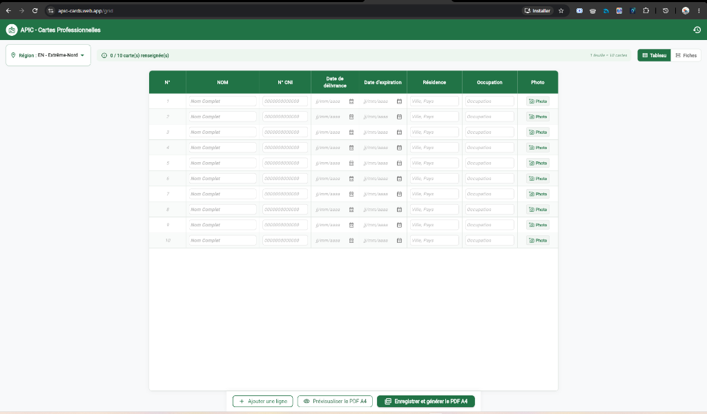
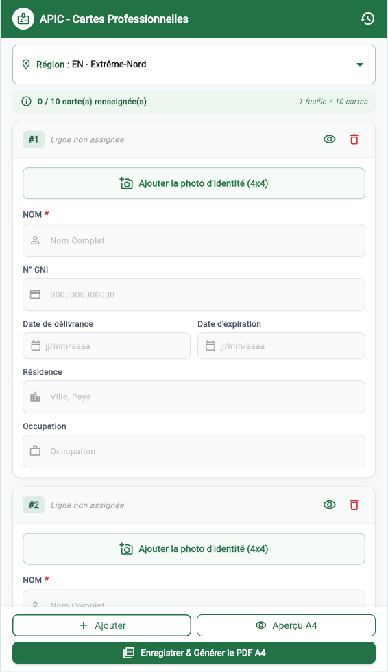
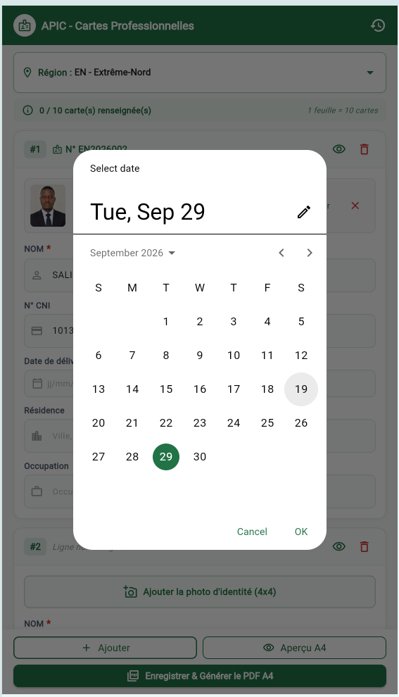
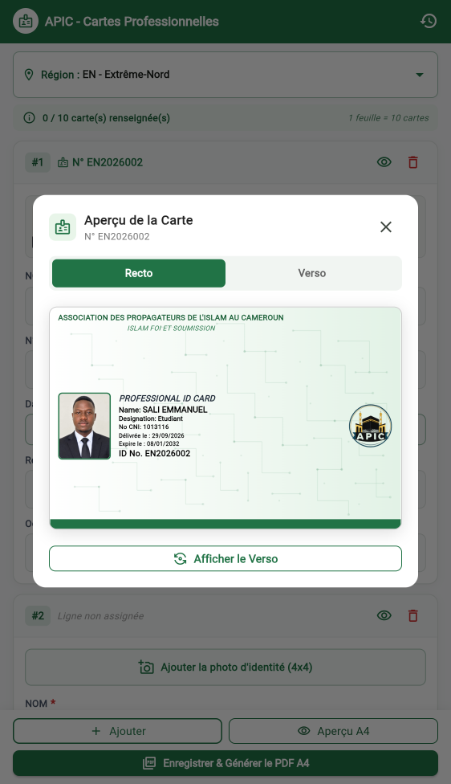
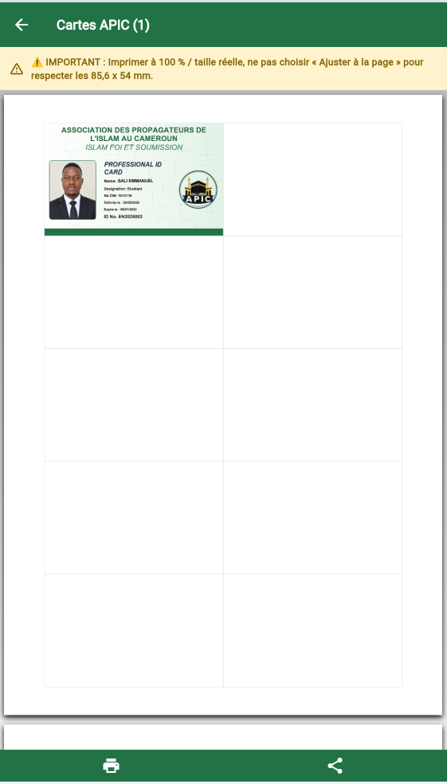

# 🪪 APIC Cards — Générateur de Cartes Professionnelles

Application Flutter multiplateforme (Web, Android, Desktop) conçue pour la création, la prévisualisation, l'impression et l'exportation de cartes d'identité professionnelles pour les membres de l'**APIC** (*Association des Propagateurs de l'Islam au Cameroun*).

[](https://apic-cards.web.app/)

> 🌐 **Lien d'accès direct à l'application web :** [https://apic-cards.web.app/](https://apic-cards.web.app/)

---

## 📋 Table des Matières

- [Aperçu de l'Application (Captures d'écran)](#-aperçu-de-lapplication)
- [Fonctionnalités Principales](#-fonctionnalités-principales)
- [Spécifications de la Carte](#-spécifications-de-la-carte)
- [Architecture & Technologies](#-architecture--technologies)
- [Structure du Projet](#-structure-du-projet)
- [Installation & Démarrage](#-installation--démarrage)
- [Compilation & Déploiement](#-compilation--déploiement)
- [Mentions Légales & Association](#-mentions-légales--association)

---

## 📸 Aperçu de l'Application

<div align="center">

### Vues Principales de Saisie

| 🖥️ Saisie par lots (Mode Tableau — Desktop) | 📱 Saisie individuelle (Mode Fiches — Mobile) |
| :---: | :---: |
|  |  |

<br/>

### Interactions, Prévisualisation & Impression PDF

| 📅 Sélecteur de date | 🪪 Aperçu fidèle de la carte (Recto) | 📄 Impression et export PDF A4 (Format 100%) |
| :---: | :---: | :---: |
|  |  |  |

</div>

---

## ✨ Fonctionnalités Principales

- **Génération instantanée de cartes** :
  - Saisie des informations du membre : Nom complet, Fonction / Désignation, N° CNI, ID unique, Région, etc.
  - Importation de photo d'identité (avec recadrage et encodage base64).
  - Génération automatique de QR Code de vérification.
  - Calcul et affichage automatique de la date d'émission et de la validité d'un an (`Valable 1 an — Émise le : JJ/MM/AAAA`).

- **Aperçu interactif fidèle (Recto / Verso)** :
  - Visualisation en temps réel de la carte avant impression.
  - Rendu 100 % fidèle et identique à l'exportation PDF finale (typographie, filigranes, bordures, espacements).
  - Bascule fluide entre les faces Recto et Verso.

- **Modes de saisie adaptatifs** :
  - **Mode Formulaire** : Vue optimisée pour les smartphones et la saisie unitaire.
  - **Mode Grille (Tableau)** : Conçu pour les écrans larges/ordinateurs, permettant la gestion rapide de plusieurs membres par lots.
  - Détection automatique de la taille d'écran (bascule automatique en mode sans grille sur mobile).

- **Export PDF & Impression calibrée** :
  - Génération de documents PDF A4 haute définition vectorielle.
  - Respect scrupuleux des dimensions réelles des cartes (repères de coupe, format 100 % taille réelle).
  - Mention légale de validité et consignes d'impression en bas de page A4.
  - Impression directe via le plugin `printing` ou téléchargement du PDF.

- **Historique & Persistance locale** :
  - Sauvegarde locale des membres générés (via `shared_preferences`).
  - Consultation, réimpression et gestion de l'historique sans connexion Internet requise.

---

## 📐 Spécifications de la Carte

Les cartes respectent les normes des badges d'identification plastifiés :

| Propriété | Spécification |
| :--- | :--- |
| **Format** | Standard CR80 / ISO 7810 (Format Carte Bancaire) |
| **Dimensions** | 85,60 mm × 53,98 mm (ratio standard 1.586) |
| **Faces** | Recto (Identité, Photo, QR Code) & Verso (Mentions légales, Coordonnées) |
| **Bandeau de validité** | `Valable 1 an — Émise le : JJ/MM/AAAA` (sur les deux faces) |
| **Mise en page d'impression** | Page A4 centrée avec repères de découpe et avertissement 100 % |

---

## 🛠 Architecture & Technologies

Le projet suit les principes de la **Clean Architecture** (Architecture Propre) combinée avec **GetX** pour la réactivité :

- **Framework** : [Flutter](https://flutter.dev) (SDK Dart ^3.13)
- **Gestion d'état & Dépendances** : [GetX](https://pub.dev/packages/get)
- **Génération & Impression PDF** : [pdf](https://pub.dev/packages/pdf), [printing](https://pub.dev/packages/printing)
- **Persistance locale** : [shared_preferences](https://pub.dev/packages/shared_preferences)
- **Sélecteur d'images** : [image_picker](https://pub.dev/packages/image_picker)
- **Hébergement Web** : [Firebase Hosting](https://firebase.google.com/docs/hosting)

---

## 📁 Structure du Projet

```text
lib/
├── app/                      # Configuration globale de l'application (routes, thèmes)
├── core/
│   ├── constants/            # Couleurs officielles (AppColors), Textes (AppStrings)
│   └── utils/                # Formateurs de date, helpers d'images
├── data/
│   ├── datasources/          # Sources de données locales (SharedPreferences)
│   ├── models/               # Modèles de données sérialisables (MemberModel)
│   ├── repositories/         # Implémentations des contrats de repository
│   └── services/             # Génération PDF (CardPdfGeneratorImpl)
├── domain/
│   ├── entities/             # Entités pures métier (Member)
│   ├── repositories/         # Interfaces abstraites des dépôts
│   └── usecases/             # Cas d'usage métier
├── presentation/
│   ├── bindings/             # Injections de dépendances GetX
│   ├── controllers/          # Contrôleurs réactifs (CardController, etc.)
│   ├── pages/                # Vues principales (GridPage, HistoryPage, PdfPreviewPage)
│   └── widgets/              # Widgets réutilisables (CardPreviewDialog, etc.)
└── main.dart                 # Point d'entrée de l'application
```

---

## 🚀 Installation & Démarrage

### Prérequis
- [Flutter SDK](https://docs.flutter.dev/get-started/install) (version 3.13 ou supérieure)
- Android SDK (pour compiler l'application mobile Android)
- Navigateur moderne (Chrome, Edge, Firefox) pour le Web

### Cloner le dépôt et installer les dépendances
```bash
git clone <url-du-depot>
cd apic_cards
flutter pub get
```

### Lancer en développement
- **Sur le Web** :
  ```bash
  flutter run -d chrome
  ```
- **Sur Android (émulateur ou appareil connecté)** :
  ```bash
  flutter run -d android
  ```

---

## 📦 Compilation & Déploiement

### 1. Build Web & Déploiement Firebase
```bash
# Compilation de la version web minifiée
flutter build web --release

# Déploiement sur Firebase Hosting
npx firebase-tools deploy --only hosting
```

### 2. Build Android (APK Release)
```bash
flutter build apk --release
```
Le fichier généré se trouvera dans :
`build/app/outputs/flutter-apk/app-release.apk`

---

## 🏛 Mentions Légales & Association

- **Organisation** : *Association des Propagateurs de l'Islam au Cameroun* (**APIC**)
- **Devise** : *Islam Foi et Soumission*
- **Bureau** : N° EN/REC/2025 Bureau : N° A2-3 Carrefour Schell, BP : 945 Maroua Cameroun
- **Contact** : 699 3690 86
